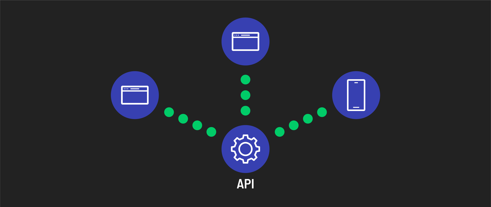

# 

**Learning objective:** By the end of this lesson, students will be able to explain what an API is and how they are used.

## What is an API?

An API (Application Programming Interface) is a set of rules and definitions that allows one software application to interact with another. In web development what we typically refer to *as* an API is actually a resource or set of resources *governed by* an API.

APIs by this definition, provide a set of data or functionality that developers can use when building their own applications.

### Types of APIs

- **Third-party APIs** : Created by a company or organization that is not the same company or organization that is using the API.

- **Internal APIs**: Used within a company to enable different teams or parts of a system to communicate.

### Examples

**Third-party APIs:** 

- [PokeAPI](https://pokeapi.co/) - Developers can use this API to create applications, games, or websites that require detailed Pokémon information without needing to gather and manage this extensive data themselves.
- [Google Maps API](https://developers.google.com/maps/documentation/javascript/overview) - The Google Maps API is a set of interfaces provided by Google that allow developers to integrate mapping services into their applications.
- [Stripe API](https://stripe.com/docs/api) - The Stripe API is essential for e-commerce websites, subscription-based services, and any online platform that needs to process payments securely and efficiently.

**Internal APIs:**

- A banks internal account management system
- A Healthcare network's patient records system

## How APIs control data

Imagine you're developing an app for users to track their Pokemon card collections. Instead of manually entering all Pokemon card data into your database, you can integrate the PokeAPI. This simplifies the process significantly as the API already contains the comprehensive Pokemon data, and your task is merely accessing this data using the API.

**Why not access the database directly?**

You might wonder why the developers of PokeAPI didn't just share the database access URL for direct queries. There are two main reasons:

**Security:** Direct database access can pose significant security risks. It could expose the database to unauthorized access and potential malicious attacks.

**Controlled access** By building an API, the developers of PokeAPI have more control over how the data is accessed and used. They can optimize data delivery, manage traffic, and ensure that the database remains secure and efficient.