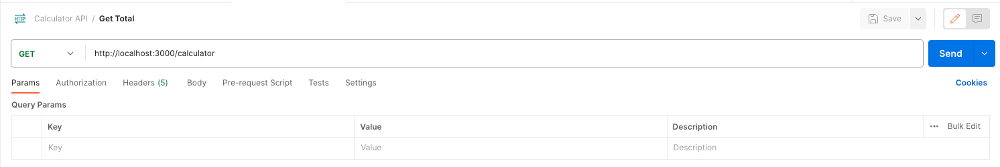

# ![[Exposing a GET Request] - Exposing a GET Request](./assets/tktk-hero.png)

**Learning objective:** By the end of this lesson, students will be able to write a `GET` route and use Postman to consume from it.

## Calculator API

In this lesson, we will be creating a simple calculator API. This API will have four routes:

| HTTP Method | Route         | Description                                             |
|-------------|---------------|---------------------------------------------------------|
| GET         | /calculator   | Returns the current total of the calculator.            |
| POST        | /calculator   | Accepts a number and an operation to update the total.  |
| DELETE      | /calculator   | Resets the total of the calculator to 0.                |

## Exposing a GET Request

Before building out our first route, we will need to somehow store the `total` of the calculator. We could add a database to our application to store the total. Still, we will just store the total in a variable for this lesson. We will start with a total of 0.

```js
// ... Require statements located above

let total = 0;

// Routes will be defined here

// Listening for requests on port 3000 below
```

> 🧠 We are using `let` instead of `const` because we will update the value of `total` when we build our `POST` request.

Let's build out the first route for our calculator API. This route will return the current total of the calculator. We will use the `GET` HTTP method for this route because we are not expecting any user data. We will also use the `/calculator` route. This means that the entire route will be `GET /calculator`.

Before we build the route, let's review some of the main components of making an API:

- **Endpoint** - This endpoint is `/calculator`.
- **Request** - Users will make a `GET` request to this endpoint and be expected to provide no data.
- **Response** - We will return a JSON object with the current total of the calculator.

Now that we have reviewed the main components of making an API, let's build out the route. We will use the `app.get()` method to create the route.

```js
// ... Require statements located above

let total = 0;

// Routes will be defined here
app.get('/calculator', (req, res) => {
  // Code will go here
});

// Listening for requests on port 3000 below
```

In this route, we only want to return the total of the calculator. We can send the `total` back as a JSON object. We can use the [`res.json()`](https://expressjs.com/en/5x/api.html#res.json) method to accomplish this goal. This method takes one argument: the data that we want to send back. In this case, we want to return the total, so we will pass in the `total` variable.

```js
// ... Require statements located above

let total = 0;

// Routes will be defined here
app.get('/calculator', (req, res) => {
  res.json({ total });
});

// Listening for requests on port 3000 below
```
> 🧠 We are using the shorthand syntax for the object. This is the same as writing `{ total: total }`. But why are we doing this? As a simple API, we know we will only return the total. However, if we were building a more complex API, we might return more data. So, by including a key that represents the data we are returning, we are making it easier for other developers and applications to use our API.

## Testing a GET API Endpoint

We have come to a point where we can start testing this endpoint. Since this is a `GET` request, we could use the browser and navigate to `http://localhost:3000/calculator`. However, we will be using Postman to test our API. Open Postman, and let's create a new collection to contain our requests. Follow the steps to get started in a new collection:

- Click on the `New` button in the top left corner of the Postman window.
- Select `Collection` from the menu.
- Rename the collection from `New Collection` to `Calculator API`.

Now that we have a collection, let's add a new request to test this endpoint. Make sure to have your left sidebar open in Postman to Collections:

- You should see your `Calculator API` collection in the Collections sidebar.
- Click on the `...` next to the collection name.
- Select `Add Request` from the menu. Name the request `Get Total`.
- Make sure that the `GET` method is selected.
- Enter `http://localhost:3000/calculator` in the address bar.
- Click the save button in the top right corner of the Postman window.



Now that we have created the request, we can test it. Click on the `Send` button to send the request. You should see the response in the bottom half of the Postman window. You should see the following response:

```json
{
  "total": 0
}
```
