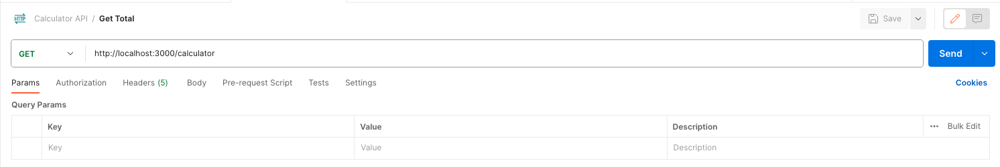

# 

**Learning objective:** By the end of this lesson, students will be able to develop and test a simple calculator API with a GET method.

## Calculator API

In this lesson, we will be creating a simple calculator API. This API will have three routes:

| HTTP Method | Route         | Description                                             |
|-------------|---------------|---------------------------------------------------------|
| GET         | /calculator   | Returns the current total of the calculator.            |
| POST        | /calculator   | Accepts a number and an operation to update the total.  |
| DELETE      | /calculator   | Resets the total of the calculator to 0.                |

## Exposing a GET Route

Before building out our first route, we will need to store the `total` of our calculator. We will start with a total of 0.

Add total to `server.js`:

```js
const express = require('express');
const app = express();

// to track our calculator total
let total = 0;

app.listen(3000, () => {
  console.log('Server listening on port 3000');
});
```

>  We are using `let` instead of `const` here because our application will update the value of `total` each time we receive a request to alter the total (such as adding, subtracting, etc.)

### Building the route

Let's build out the first route for our calculator API. This route's purpose is to return the current total of the calculator.

First we'll define the key components for our route:

  - **Endpoint:** Our endpoint will be `/calculator`.
  - **HTTP Method:** We will use the `GET` method because this route is designed to retrieve the current total, not to receive any user input.
  - **Response:** The response will be a `JSON` object representing the **current total**.

Now we are ready to build out the route. In Express we will use the `app.get()` method:

```js
let total = 0;

app.get('/calculator', (req, res) => {
  // code will go here
});
```

Inside the callback function, we will set up the logic to send back the current total. We can use Express' [`res.json()`](https://expressjs.com/en/5x/api.html#res.json) method to send a `JSON` response. Here, we'll send back an object that includes the current value of total

```js
let total = 0;

app.get('/calculator', (req, res) => {
  res.json({ total });
});
```

> 🧠 In our response, we are utilizing shorthand syntax in JavaScript for object creation. This means when we write `{ total }`, it is equivalent to `{ total: total }`. The key total is automatically assigned the value of the total variable. 

### Don't forget to add a status code! 

Incorporating HTTP status codes in your application is a hallmark of professionalism and attention to detail. These codes offer immediate feedback about the outcome of each request. This practice not only makes your application more readable and user-friendly but also demonstrates your knowledge best coding practices and industry standards.

Adding status codes to your responses in Express is easy with the `status()` method of the response (res) object. You can use this method right before you send a response back. Simply chain `status()` with the response method you're using, such as `.send()`, `.render()`, or `.json()`. This way, you first set the HTTP status code and then send your response. 

Example:

```js
res.status(200).json({ total });
```

> In the context of web servers and APIs, when a server returns a `200` OK response, it means that the request was received, understood, and processed as expected. 


## Testing in Postman

Since this is a `GET` request, we could use the browser and navigate to `http://localhost:3000/calculator` to test our route. However, for this lesson we will practice using Postman.

Let's start the server and launch the Postman application. 

```bash
nodemon
```

Once in Postman, follow the following steps to get started:

1. Click on the `New` button in the top left corner of the Postman window.

2. Select `Collection` from the menu.

3. Rename the collection from `New Collection` to `Calculator API`.

<br>

Now that we have a collection, let's add a new request to test this endpoint:

4. You should see your `Calculator API` collection in the Collections sidebar.

5. Click on the `...` next to the collection name.

6. Select `Add Request` from the menu. Name the request `Get Total`.

7. Make sure that the `GET` method is selected.

8. Enter `http://localhost:3000/calculator` in the address bar.

9. Click the save button in the top right corner of the Postman window.

<br>



Now that we have created the request, we can send it. Click on the `Send` button to send the request. You should see the response in the bottom half of the Postman window:

```json
{
  "total": 0
}
```
