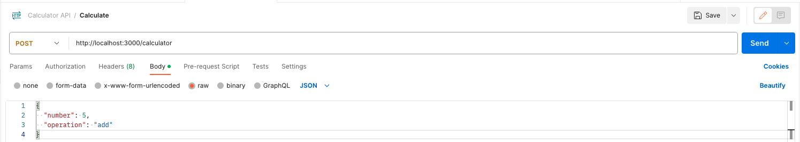

# ![[Exposing a POST Request] - Exposing a POST Request](./assets/tktk-hero.png)

**Learning objective:** By the end of this lesson, students will be able to write a `POST` route and use Postman to post to it.

## Exposing a POST Request

Now that we have built out the `GET` route for our calculator API, let's build out the `POST` route. This route will accept a number and an operation and update the total of the calculator. We will use this route's `POST` HTTP method because we expect user data. We will also use the `/calculator` route. This means that the entire route will be `POST /calculator`.

Looping back to the main components of making an API:

- **Endpoint** - This endpoint is `/calculator`.
- **Request** - Users will make a `POST` request to this endpoint and be expected to provide a number and an operation.
- **Response** - We will return a JSON object with the current total of the calculator.

Since we expect the user to send in some data, it's always best to determine first what shape we expect that incoming data to be in. In this case, we expect the user to send in a number and an operation. We will use the following format for the expected incoming data:

```json
{
  "number": 5,
  "operation": "add"
}
```

We will use the `app.post()` method to create the route. With the ' POST ' HTTP method, this route will listen for incoming requests to the `/calculator` endpoint.

```js
// ... app.get request located above

app.post('/calculator', (req, res) => {
  // Code will go here
});

// Listening for requests on port 3000 below
```

In this route, we want to update the `total` variable and return the results in a JSON object. We are collecting the data from the incoming request in the `req.body` object. We expect the incoming request to have a key of `number` and `operation`. Let's start by getting the data from the request and storing it in a variable.

```js
// ... app.get request located above

app.post('/calculator', (req, res) => {
  const { number, operation } = req.body;
});

// Listening for requests on port 3000 below
```

> We are using [destructuring](https://www.javascripttutorial.net/es6/javascript-object-destructuring/) to get the `number` and `operation` from the `req.body` object.

We have a couple of options from here to calculate the new total. We could use a `switch` statement or a series of `if` statements. Both accomplish the same goal. For this lesson, we will use a `switch` statement. We will use the `operation` variable to determine which operation to use. We will use the following cases:

```js
// ... app.get request located above

app.post('/calculator', (req, res) => {
  const { number, operation } = req.body;

  switch (operation) {
    case 'add':
      total += number;
      break;
    case 'subtract':
      total -= number;
      break;
    case 'multiply':
      total *= number;
      break;
    case 'divide':
      total /= number;
      break;
    default:
      return res.json({ error: 'Invalid operation' });
      break;
  }
});
// Listening for requests on port 3000 below
```

> We use the `break` keyword to stop the `switch` statement from running after finding the correct case. We also use the `default` keyword to handle any invalid operations we might receive.

Now that we have updated the `total` variable, we can return the new total in a JSON object. Still using the `res.json()` method, we can return the new total.

```js
// ... app.get request located above

app.post('/calculator', (req, res) => {
  const { number, operation } = req.body;

  switch (operation) {
    case 'add':
      total += number;
      break;
    case 'subtract':
      total -= number;
      break;
    case 'multiply':
      total *= number;
      break;
    case 'divide':
      total /= number;
      break;
    default:
      return res.json({ error: 'Invalid operation' });
  }

  res.json({ total });
});
// Listening for requests on port 3000 below
```

## Testing a POST API Endpoint

Once again, we are at the point of testing. But before we can start testing, we need to talk about a limitation to Express. By default, Express does not accept JSON data from a request. We must add a middleware to our application to allow Express to accept incoming JSON data. 

Luckily, there is an easy way to do this. We can use the [`express.json()`](https://expressjs.com/en/5x/api.html#express.json) middleware. This middleware will parse incoming JSON data and add it to the `req.body` object. We will add this middleware to our application before we define our routes.

```js
const express = require('express');
const app = express();

app.use(express.json());

// Total variable and routes are below
```

> 🧠 We are using [`app.use()`](https://expressjs.com/en/5x/api.html#app.use) to add the middleware to our application.

With our API now accepting JSON, we can use Postman to test. Back in Postman, make sure you are in the collection `Calculator API`, and let's create a new request:

- Click on the `...` next to the collection name.
- Select `Add Request`. Name the request `Calculate`.
- Change the HTTP method to `POST`.
- Change the URL to `http://localhost:3000/calculator`.
- Click on the `Body` tab.
- Select `raw` from the tabs.
- Change the dropdown to `JSON`.
- Add the following JSON to the body:

```json
{
  "number": 5,
  "operation": "add"
}
```



Remember to save this request. Once saved, click the `Send` button to send the request. You should see the following response:

```json
{
  "total": 5
}
```

## You do: Exposing a DELETE Request

We have done two routes together, and now it's time to stretch our legs and try this ourselves. The goal is to create a `DELETE` route that will reset the total of the calculator. We will use the following components to build this route:

- **Endpoint** - This endpoint is `/calculator`.
- **Request** - Users will make a `DELETE` request to this endpoint and be expected to provide no data.
- **Response** - We will return a status code of no content.
